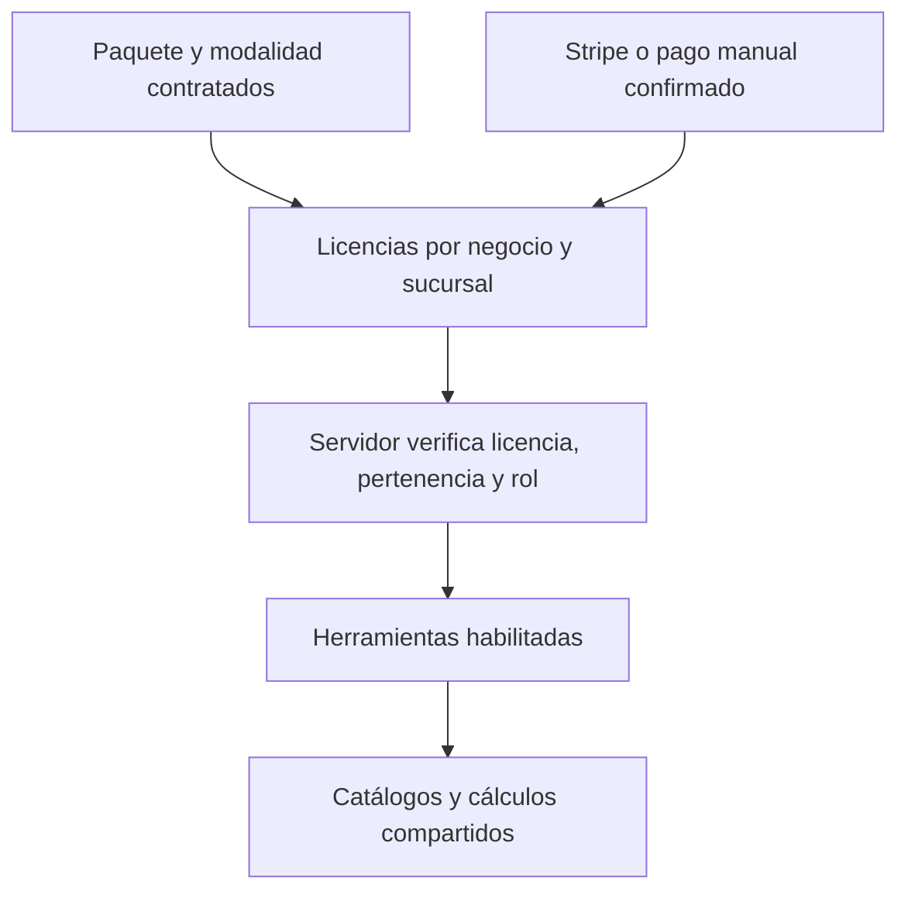

**ETAAX: auditoría técnica y propuesta de servicios independientes**  
31 de octubre de 2026 · Revisión del repositorio y consultas de solo lectura a producción.  
Código publicado: `05ef15e8b9f4ac6bd8be0c9572ec7c8b69e66ee5`.

La venta por módulos es viable reutilizando el sistema actual. Recomiendo una sola plataforma con herramientas contratables y una base compartida de catálogos, unidades y sucursales. No hace falta dividir ETAAX en aplicaciones independientes ni rehacer el frontend para comenzar. Sí hace falta separar la contratación del negocio de los permisos de sus colaboradores y consolidar la integridad de datos antes de automatizar migraciones.

Este informe es un diagnóstico y una propuesta. No modifica precios, contratos, permisos operativos ni titularidad de sucursales. No certifica todos los cálculos históricos ni sustituye una prueba completa con sesiones reales de cada rol.

**Trabajo que ya quedó publicado**

El admin tiene botón y pestaña **Historial de recibos**. Permite archivar recibos/presupuestos antes de imprimir, consultar por cliente/folio, registrar pendiente/pagado/anulado, reimprimir, descargar originales, importar PDF y exportar CSV. Los importes y documentos originales no se sobrescriben al cambiar el estado.

Se aplicó la migración v81 al proyecto enlazado. Se recuperaron 4 recibos y 2 presupuestos de los PDF locales. Los 6 coinciden con sus originales mediante SHA-256. Dos recibos mezclan consultoría y plataforma sin desglose: requieren clasificación para MRR. Dos presupuestos sin folio usan identificadores de archivo ARCH, conservando intacto el original. Los PDF y los datos de clientes no se publicaron en Git ni en Netlify.

El MRR de esta pantalla es **MRR documentado**: distribuye suscripciones entre meses cubiertos y excluye servicios, presupuestos y anulados. No es todavía el MRR contractual de todas las cuentas activas, no activa licencias ni concilia automáticamente Stripe. Encontré también dos eventos anteriores de Stripe, uno sin negocio asociado; un evento no equivale necesariamente a un recibo adicional. No fabriqué comprobantes ni dupliqué ingresos a partir de ellos.

El catálogo ETAAX ya detecta imágenes nuevas aunque el costo no cambie, permite revisar/aplicar la foto y resuelve el origen de copias de sucursal. Una caché vacía no borra la imagen maestra.

Validación: 4,827 comprobaciones de fórmulas; 84 de almacenamiento; 10 casos de navegador en escritorio/móvil; 11 casos SQL y 6 de actualización de fotos. Todos pasaron. El navegador usó Supabase simulado; además se verificaron esquema/RLS e integridad de originales en producción. Se verificó el despliegue público: scripts y estilos coinciden; Netlify solo reescribe dos enlaces de navegación del HTML del admin.

**La propuesta comercial**

Los importes siguientes son únicamente los ejemplos del usuario. Propongo entenderlos inicialmente por sucursal al mes, porque ese es el esquema de cobro actual; debe quedar visible en la oferta.

| Servicio | Contenido | Ejemplo mensual |
| --- | --- | ---: |
| Costeo estándar | Escandallos, subrecetas y catálogo de insumos con sus presentaciones | $299 |
| Costeo premium | Lo anterior + inventarios y requisiciones | $499 |
| Administración | Ventas/cortes, gastos, caja fuerte, movimientos, bancos, previsiones, proveedores y resumen financiero | $799 |
| RH estándar | Catálogo de colaboradores y recibos de nómina | $399 |
| RH premium | Lo anterior + horarios, checklist/QR, perfiles, organigrama, reglamentos y evaluaciones | $599 |
| ETAAX completo | Costeo premium + Administración + RH premium; definir alcance de menú y corporativo | $1,799 |
| Inventarios independiente | Catálogo operativo, existencias, entradas, salidas, conteos, producción/prebatch y reportes; requisiciones según edición | Por validar |

Si inventarios solo existe dentro de Costeo premium, todavía no se está vendiendo como servicio independiente. Puede ser una entrada comercial propia y habilitar las mismas capacidades internas del paquete, sin duplicar inventarios ni cobros cuando el cliente suba de plan.

Menú digital, reportes corporativos y herramientas operativas deben figurar explícitamente en una matriz de inclusión. El catálogo mínimo de insumos/proveedores o colaboradores puede ser una dependencia incluida en varios servicios; cobrar dos veces esa misma dependencia genera fricción. Compartir datos no significa compartir todos los permisos: Finanzas podría consumir el costo de nómina sin dar acceso al expediente personal completo.

La landing debería presentar resultados: «Costea tus recetas», «Controla tu inventario», «Administra tu operación», «Organiza a tu equipo» y «Todo ETAAX». Cada tarjeta muestra alcance, sucursales incluidas, modalidad, precio y qué pasa al cambiar de plan. La comparación detallada puede quedar debajo. Recomiendo separar implementación, carga inicial y consultoría del precio recurrente si consumen trabajo relevante.

Con estos ejemplos:

- Tres premium: $499 + $799 + $599 = **$1,897**. Completo ahorra **$98/mes (5.17%)**.
- Tres estándar: $299 + $799 + $399 = **$1,497**. Completo cuesta $302 más y debe explicar las funciones adicionales.
- 30% de descuento sobre $1,799 deja **$1,259.30/mes**; 50% deja **$899.50/mes** equivalentes. Son escenarios aritméticos, no precios recomendados ni estimaciones de rentabilidad.

No recomiendo inflar precios para forzar el paquete completo. Recomiendo probar que cada servicio se vende por su propio resultado y que el paquete ahorra frente a precios que realmente se cobran. La decisión de descuento necesita costos de soporte, implementación, infraestructura, cobro y abandono; no se conocen todavía para fijar un margen sostenible.

Distinguir tres condiciones: mensual flexible, anual pagado por adelantado y compromiso anual con cobros mensuales. Una promoción debe indicar duración, renovación y condiciones. Los descuentos por paquete, volumen, anualidad y campaña necesitan reglas explícitas de combinación; no sumarlos todos automáticamente. Para empezar, probar una oferta acotada con clientes reales y medir tiempo hasta primer inventario útil, exactitud, horas de soporte, activación y renovación.

**Hallazgos técnicos verificados**

| Prioridad | Evidencia | Implicación |
| --- | --- | --- |
| Alta | `precios.js` tiene una escalera única desde $1,799; `crear-checkout/index.ts` usa un `price` y cantidad de sucursales. La tabla `suscripciones` no contiene productos ni capacidades. | Falta el modelo de contratación por herramienta. Cambiar tarjetas de la landing no lo implementa. |
| Alta | `page-guard.js:566` da acceso total a dueño/admin; las políticas vivas de recetas, inventarios e insumos validan negocio o admin, no plan ni sucursal del colaborador. | Licencia comercial, pertenencia y rol deben comprobarse en servidor. Ocultar rutas no impide llamar a la API. Esto describe los límites actuales; no demuestra acceso anónimo ni una fuga entre negocios. |
| Alta | `sync-suscripcion/index.ts:97` modifica solo `items.data[0]`; `stripe-webhook/index.ts:167` manda `p_meses:1`. | No habilitar múltiples productos o anualidades sin adaptar sincronización, periodos y conciliación. |
| Alta | `negocio_insumos` tiene PK `(negocio_id, insumo_id)` pero no FK al negocio, ni unicidad por maestro/sucursal. `recetas` tiene PK global `id`; sucursales/referencias están en JSON. | El aislamiento por negocio existe mediante RLS, pero la integridad de relaciones y sucursal depende demasiado del cliente. |
| Alta | Producción tiene 109 insumos cuyos dos negocios ya no existen; hay otros 2 registros con sentinel interno `__catalogo__`. | Revisar recuperación/papelera/origen antes de reasignar o limpiar. Los 2 del sentinel no deben tratarse como negocios borrados. |
| Alta | Entre 1,564 recetas hay 22 referencias sin insumo local exacto: 6 resuelven por copia local, 4 solo al catálogo ETAAX, 10 no resuelven y 2 solo existen en otro negocio. | Son casos para revisión, no una orden de fusionar ni borrar. Las coincidencias en otro negocio no autorizan utilizarlas. |
| Alta | `recetas/requisiciones.html:596` pide `negocio_insumos.created_at`; confirmé que la columna no existe. El error deja la caché como respaldo. | Una sesión nueva puede no cargar el catálogo. Corregir y probar antes de vender el servicio separado. |
| Media | `_sbInitInv` hace cuatro lecturas sin paginación; el negocio más grande tiene 923 insumos y el máximo de entradas es 806. | Riesgo de catálogo/movimientos parciales al alcanzar el límite de API. No se verificó el límite configurado de producción; 1,000 es el predeterminado documentado por Supabase. No afirmo que hoy esté truncando. |
| Media | El portal público anuncia Free permanente y Pro «precio disponible pronto» (`index.html:655`); el cobro vigente ya usa $1,799 por sucursal. | Marketing, contrato y checkout necesitan una única definición de oferta. |
| Media | `inventarios.js` tiene más de 12 mil líneas y cálculos compartidos con recetas/catálogos. | Separar carga, conversión, movimientos, cálculo y reportes gradualmente. Mantener el núcleo probado; una reescritura completa no es requisito de la oferta modular. |

La consulta agrupada por maestro/sucursal no encontró duplicados directos en esa muestra de producción. No prueba ausencia de duplicados semánticos, cadenas de origen mal formadas o registros sin sucursal. Los IDs de JSON coincidieron con los IDs de columna en los 4,097 insumos y 1,564 recetas revisados.

**Modelo técnico propuesto**

Mantener el repositorio y Supabase. Agregar un catálogo versionado de productos/precios, una lista estable de capacidades y licencias con negocio, sucursales cubiertas, vigencia y fuente de activación. Ejemplos de capacidades: recetas, insumos, inventarios, requisiciones, administración, RH básico, RH operativo, menú y corporativo. El precio puede cambiar sin renombrar la capacidad ni alterar contratos antiguos.

Regla efectiva: sesión válida + negocio/sucursal autorizados + capacidad contratada y vigente + permiso para la acción. El dueño conserva administración de su cuenta, pero no adquiere una herramienta sin contratarla. Una excepción del admin maestro debe ser explícita y auditable. Las políticas permisivas existentes se combinan con OR: agregar otra política de acceso no revoca las anteriores; hace falta una migración controlada de políticas/RPC, incluidos QR y Storage.

Stripe permite varios productos dentro de una suscripción y un solo cobro. Sus Entitlements permiten asociar funciones con productos. Esto puede alimentar ETAAX, pero se necesita una asignación local a sucursales y soporte de pagos manuales; el customer de Stripe por sí solo no conoce qué sucursal puede usar cada función. Referencias: [productos y cantidades](https://docs.stripe.com/billing/subscriptions/quantities), [acceso por capacidades](https://docs.stripe.com/billing/entitlements?dashboard-or-api=api).

La licencia y la contabilidad de cobros deben ser entidades separadas. Presupuesto, documento por cobrar, pago recibido, asignación del pago y derecho de acceso son estados relacionados, no el mismo registro. Eso permitirá después abonos, saldos, cancelaciones y MRR contractual sin confundir cotizaciones con ingresos. Stripe ya ofrece promociones con duración y restricciones; el servidor debe definir qué descuento corresponde, no aceptar un importe arbitrario del navegador. Referencia: [cupones y promociones](https://docs.stripe.com/billing/subscriptions/coupons).

**Inventarios como producto**

Incluir desde el arranque: catálogo de insumos y unidades/presentaciones, área y sucursal, entradas/salidas, captura inicial, comparación teórico/físico, reportes y responsables. Para consumo por recetas y prebatch se necesita la composición de recetas/subrecetas: puede ofrecerse como configuración operativa del inventario o formar parte de la edición premium. No debe depender de visitar primero Costeo para llenar una caché.

Las requisiciones requieren catálogo y proveedores; su sugerido usa además datos de cortes/ventas en el código actual. Si se venden sin Administración, debe existir captura/importación propia o una función reducida claramente indicada, sin consultar tablas de un módulo no contratado. Lo mismo aplica a Finanzas cuando clasifica nómina usando `staff`.

Antes del piloto: lectura completa con paginación y aviso de datos incompletos; apertura desde navegador limpio; pruebas por todas las familias/unidades y presentaciones; cambios entre sucursales; producción/prebatch; QR; cola offline; reimpresión de cierres. Definir qué datos quedan congelados en el cierre y cómo se corrige mediante un ajuste trazable. Los tests existentes ayudan, pero no garantizan por sí solos cada reporte real de producción.

Supabase documenta el límite de filas por defecto y el uso de paginación: [select](https://supabase.com/docs/reference/javascript/select). `etaaxLeerTodo` ya existe para varias tablas en `etaax-db.js`; debe adaptarse a la clave `insumo_id` del catálogo antes de reutilizarlo allí.

**Identidades y traslado de sucursales**

Recomiendo formalizar cuatro referencias: producto maestro de ETAAX, maestro del negocio, ficha de sucursal y presentación/rendimiento. Cada una tiene ID estable; el nombre es editable. Una subreceta conserva su identidad y sus presentaciones estables, como se acordó previamente. El maestro global no debe guardar existencias, precios propios o datos privados de una sucursal.

`origenId` actualmente hace varios trabajos: importación, maestro y copia. Los resolvers no siempre recorren la misma profundidad; el de recetas aún usa el nombre para descartar ciertas copias. Conviene introducir relaciones explícitas, validación de pertenencia y una tabla de alias para mantener referencias históricas durante la transición. No regenerar todos los IDs ni fusionar productos por parecerse en nombre. Agregar unicidad por negocio/sucursal/maestro y comprobaciones de pertenencia en el servidor después de clasificar los datos existentes.

Una sucursal está embebida en `negocio_sucursales.datos`; `suc_principal` se reutiliza entre negocios. Cambiar solo `negocio_id` no basta. Recetas, insumos, entradas, inventarios, requisiciones, staff, nómina, horarios, checklists, gastos, bancos, archivos y QR pueden contener referencias cruzadas. La cola offline puede intentar reponer el estado anterior después del traslado.

El traslado debería ser una operación del admin con:

1. Simulación con alcance, conteos, colisiones, dependencias y bloqueos. Verificar negocio de origen/destino y facultades para mover información.
2. Decisión explícita de alcance histórico. Recomiendo empezar con operación futura y una existencia inicial de corte; conservar los documentos financieros cerrados en su entidad original. Si se necesita histórico completo, definir una política específica y conservar procedencia.
3. Respaldo y mapa de IDs. Mover referencias exclusivas; clonar/remapear maestros compartidos que deban seguir en el origen. No arrastrar datos de otras sucursales.
4. Preparación de archivos y permisos del destino. Corte controlado con revisión de escritura para rechazar colas viejas; transacción de base y pasos de Storage reintentables.
5. Revocar/reasignar QR y accesos, actualizar licencias/cobro, comparar saldos/costos/stock y registrar auditoría. Reversión preparada antes del cambio definitivo.

No encontré una función de transferencia entre negocios en la base. `copiar-sucursal.js` solo presenta un selector para copiar dentro de la lista recibida; el código que lo llama decide qué clona. `auditarCruces` es diagnóstico de coincidencias, no un motor de migración ni prueba suficiente para cambiar propietario.

**Orden de implementación recomendado**

| Fase | Entrega | Condición para avanzar |
| --- | --- | --- |
| 1 | Admin comercial: ficha de negocio/sucursal, contratos/licencias, cobros, excepciones y bitácora | Recibos conciliados con su operación; clientes actuales identificados como plan completo legado con precio y vigencia conservados |
| 2 | Integridad y acceso: revisar huérfanos/referencias, corregir lectura de requisiciones, controles de servidor y carga completa | Pruebas negativas entre negocios, sucursales, colaboradores y módulos; ninguna reasignación por nombre |
| 3 | Piloto de Inventarios independiente | Primer conteo y reporte correctos desde una cuenta nueva, sin pasar por otros módulos; medir soporte y activación |
| 4 | Catálogo de ofertas, Stripe y landing | Compra, pago manual, anualidad, cambio de paquete, cancelación y renovación probados; no cobrar módulos duplicados al subir al completo |
| 5 | Migración de sucursales desde admin | Simulación, remapeo y reversión validados en una copia de datos antes de mover una sucursal real |

La interfaz de la landing se puede preparar en paralelo después de acordar la matriz de servicios. Los cobros nuevos y restricciones comerciales deben encenderse cuando la capa de licencias esté lista. Mantener a los clientes existentes en su contrato actual evita que una mejora comercial les quite funciones inesperadamente.

Decisiones pendientes para implementar: precio por sucursal o negocio y cobertura corporativa; alcance de Inventarios independiente; ubicación de Menú/corporativo; reglas de descuentos; duración/renovación; política de históricos al trasladar sucursales. Los precios propuestos aún necesitan validación comercial y de margen.
