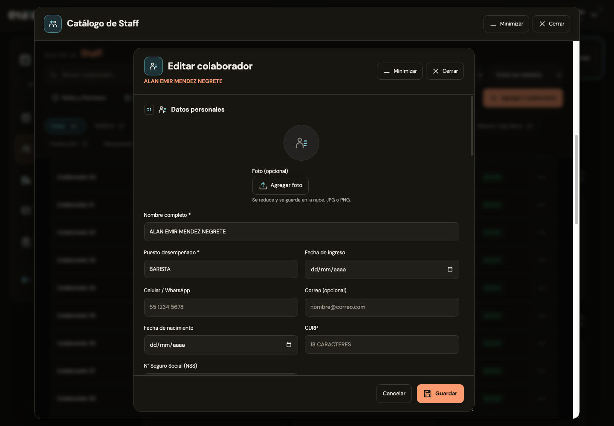
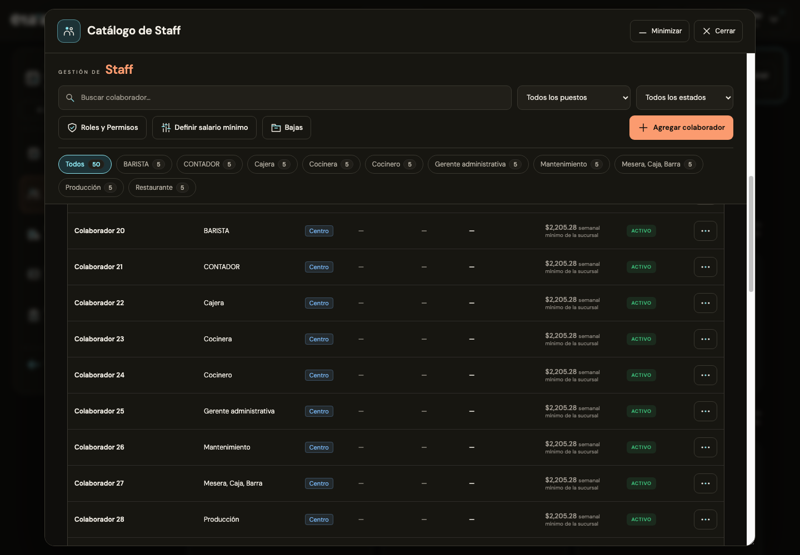
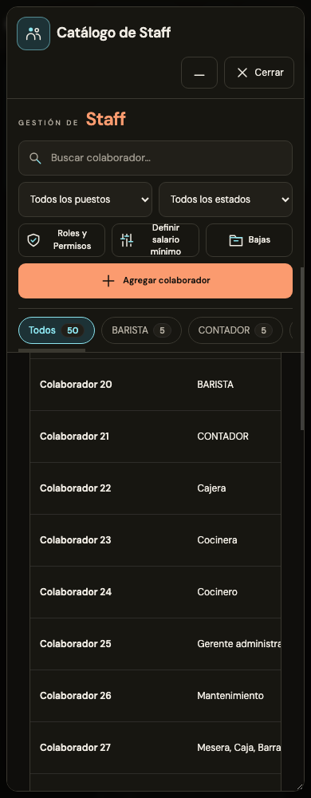

# Encabezados de Staff · 20 de octubre de 2026

El editor conserva “Editar colaborador” o “Agregar colaborador” como título principal. El nombre aparece debajo en naranja, a 13 px, siguiendo la referencia del editor de recetas. Se actualiza al escribir y se oculta cuando está vacío. Ambos editores de colaborador usan esta separación; al minimizar se conserva el nombre en la ventana del dock.

El encabezado fijo del catálogo contiene el buscador, los filtros de puesto/estado/sucursal, Roles y Permisos, salario mínimo, Bajas, Agregar colaborador y las categorías por puesto. Se trasladaron los controles existentes con sus mismos IDs y eventos. Los avisos de cumpleaños y vista global permanecen en el contenido de la lista.

En móvil los filtros se distribuyen en dos columnas y las categorías se recorren horizontalmente para conservar espacio para los colaboradores. El encabezado tiene fondo opaco en tema claro y oscuro, tanto en ventana flotante como en página completa.

Validación: 16 comprobaciones en Chrome a 1440, 768, 390 y 320 px, incluida una pantalla de 320 × 640, búsqueda y filtrado después de desplazar la lista, apertura del editor, nombre en segunda línea, actualización al escribir, minimización/restauración, segundo editor y temas claro/oscuro. Se ejecutó además la regresión de 36 casos de las seis correcciones anteriores, con los selectores del nombre adaptados a su nueva ubicación. Supabase simulado, sin modificar datos de producción.

